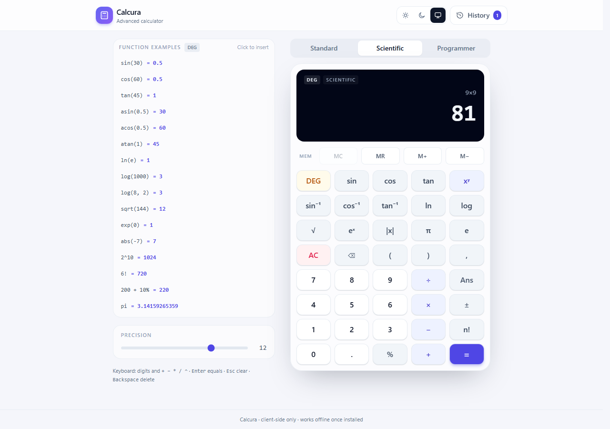
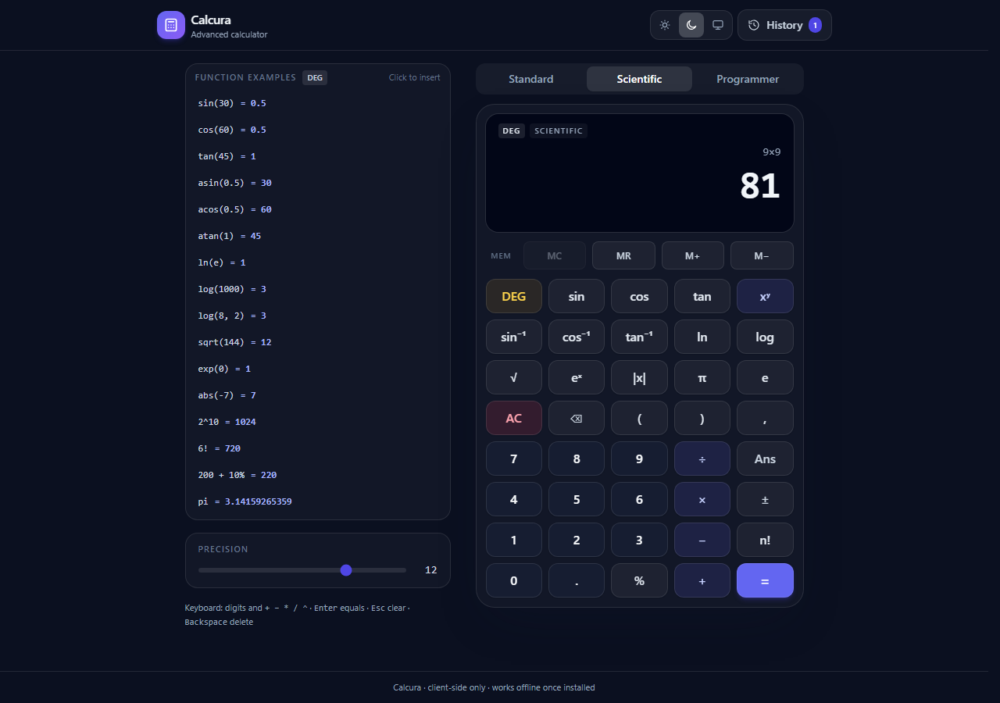
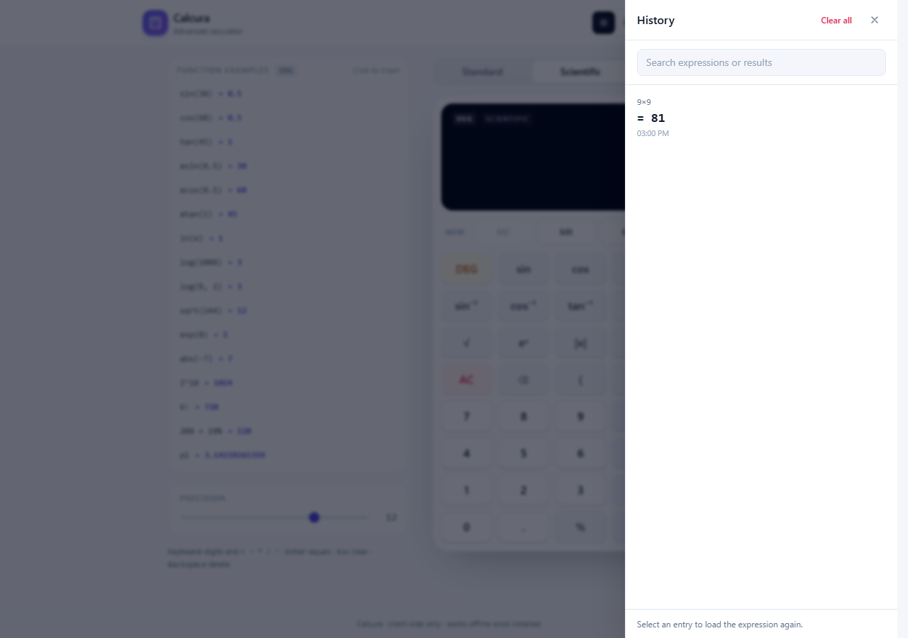
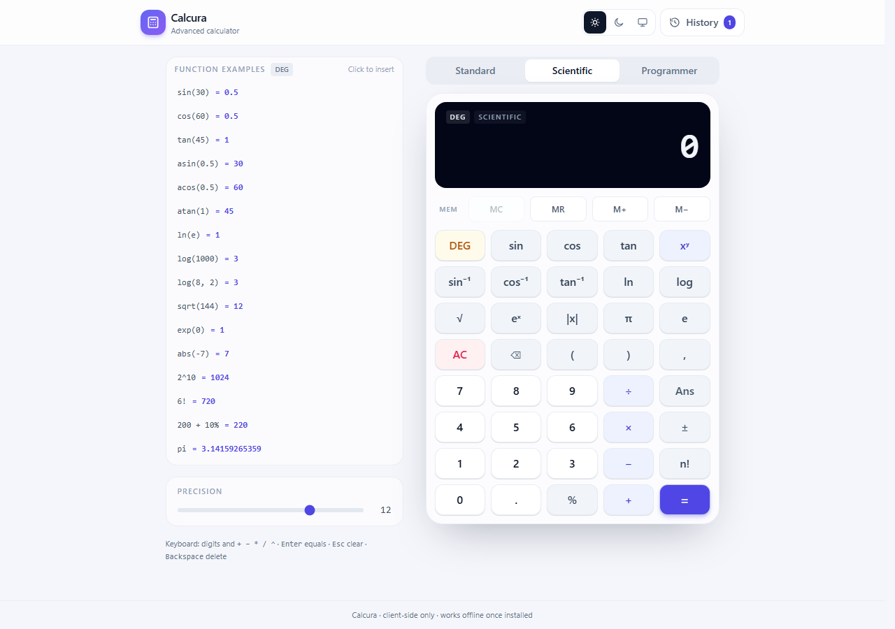
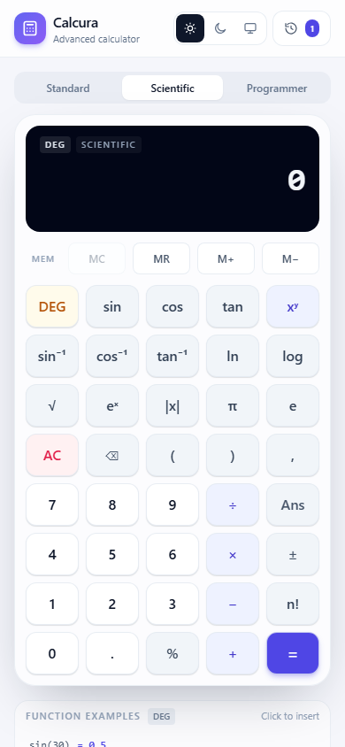

# Calcura

**A fast, offline-capable advanced calculator with a dependency-free math engine.**

Calcura is a Nuxt 3 progressive web app that evaluates real mathematical expressions —
`sin(30) + 2^3`, `log(8, 2)`, `12!`, `200 + 10%` — with a live preview, calculation
history, memory registers, three keypad layouts and full keyboard support. Everything runs
in the browser: there is no backend, no account and no network request after the first load.

---

## Features

- **Live preview** — the result updates as you type, before you press `=`.
- **Three modes** — Standard, Scientific (trig, logs, roots, factorial, powers, constants)
  and Programmer (32-bit bitwise operations with DEC/HEX/OCT/BIN readouts).
- **DEG / RAD** trig mode, shown as a badge and toggled with one key.
- **Memory** — `MC`, `MR`, `M+`, `M−` with a persistent `M` indicator.
- **Comma key** — every multi-argument function is reachable: `log(8, 2)`, `and(12, 10)`.
- **Function examples** — Scientific and Programmer modes list a worked example for every function
  (`and(12, 10) = 8`, `mod(17, 5) = 2`, `log(8, 2) = 3`). Results are computed by the engine, follow
  DEG/RAD, and a single click inserts the example into the expression. On desktop the list sits in a
  column **beside** the calculator and every example is visible at once: on short laptop screens
  (1366×768) the rows and keys tighten instead of the list scrolling inside its box.
- **History** — the last 100 calculations, searchable, click an entry to reuse it.
- **Full keyboard support** — digits, operators, `Enter`, `Esc`, `Backspace`.
- **Themes** — light, dark or system, with no flash of the wrong theme on load.
- **Precision control** — 4 to 15 significant digits.
- **Errors as UI state, never alerts** — division by zero, `sqrt(-1)`, `tan(90°)`, factorials
  of non-integers and malformed input all render a readable message in the display.
- **Installable & offline** — a service worker precaches the app shell.
- **Accessible** — labelled controls, `aria-live` display, visible focus rings, keyboard
  navigable, and motion disabled under `prefers-reduced-motion`.
- **Responsive** — one column on phones (example list below the keypad), two columns on desktop
  (examples left, calculator right) sized to fit a 1280×900 or 1366×768 window without a page scroll.

## Screenshots

Captured from the production build. The desktop shots show the two-column layout: worked examples
and precision on the left, calculator on the right, all above the fold.

| Light                                                        | Dark                                                       |
| ------------------------------------------------------------ | ---------------------------------------------------------- |
|  |  |

| History drawer                                             | Offline reload                                                        | Mobile (390 px)                              |
| ---------------------------------------------------------- | --------------------------------------------------------------------- | -------------------------------------------- |
|  |  |  |

## Tech stack


| Layer     | Choice                                            |
| --------- | ------------------------------------------------- |
| Framework | Nuxt 3 (SSR shell + client-side app)              |
| Language  | TypeScript, `strict` + `noUncheckedIndexedAccess` |
| State     | Pinia with `pinia-plugin-persistedstate`          |
| Styling   | TailwindCSS (class-based dark mode)               |
| Tests     | Vitest                                            |
| PWA       | `@vite-pwa/nuxt` (Workbox `generateSW`)           |

## Architecture

```
calcura/
├─ core/                  # ← the math engine: zero Vue/Nuxt/DOM dependencies
│  ├─ types.ts            # discriminated unions for tokens, AST, results
│  ├─ errors.ts           # typed internal CalculationError
│  ├─ tokenizer.ts        # string → Token[]
│  ├─ parser.ts           # Token[] → AST (recursive descent)
│  ├─ evaluator.ts        # AST → number (+ typed failures)
│  ├─ functions.ts        # extensible function registry
│  └─ index.ts            # public API: evaluate(), formatResult(), parse()
├─ stores/                # calculator · history · memory · settings
├─ composables/           # input routing, keyboard, theme
├─ components/            # Display, Keypad, CalcKey, MemoryBar, HistoryPanel…
├─ plugins/               # client-only persistence + theme
├─ utils/                 # keypad layouts, formatting, ids
├─ pages/index.vue        # the app shell
└─ tests/                 # engine test suites
```

### The standalone engine

`core/` is a plain TypeScript module. It imports nothing from Vue, Nuxt, Pinia or the
browser, so it can be unit-tested in Node, embedded in a worker, or copied into another
project unchanged.

The pipeline is a classic three-stage compiler:

```
"2 + 3 × sin(30)"  ──tokenizer──▶  Token[]  ──parser──▶  AST  ──evaluator──▶  number
```

- **Tokenizer** (`tokenizer.ts`) turns the input into typed tokens (`NUMBER`, `OPERATOR`,
  `LPAREN`, `FUNCTION`, `CONSTANT`, `VARIABLE`, `COMMA`), normalising `× ÷ − π **` and
  recording character positions for error messages.
- **Parser** (`parser.ts`) is a hand-written recursive-descent parser. Implicit
  multiplication (`2π`, `3(4+5)`), right-associative `^`, postfix `!` / `%` and unary signs
  are handled by grammar precedence, not by string rewriting. There is **no `eval` and no
  `new Function` anywhere in the project.**
- **Evaluator** (`evaluator.ts`) walks the typed AST. Percentages are contextual
  (`200 + 10%` is `220`), angle mode converts only at the trig boundary, and every failure
  throws an internal `CalculationError` that `evaluate()` converts into a typed
  `{ ok: false, error }` result.

### Public API

```ts
import { evaluate } from './core'

const result = evaluate('sin(30) + 2^3', {
  angleMode: 'DEG', // 'DEG' | 'RAD'
  variables: { ans: 12, m: 3, x: 1, y: 2 },
  precision: 12, // significant digits used by `formatted`
})

if (result.ok) {
  result.value // 10
  result.formatted // "10"
} else {
  result.error.code // 'division-by-zero' | 'domain-error' | 'syntax' | …
  result.error.message
}
```

Adding a function is a one-liner against the registry, and the tokenizer/parser pick it up
immediately:

```ts
import { registerFunction, evaluate } from './core'

const dispose = registerFunction({
  name: 'double',
  minArgs: 1,
  maxArgs: 1,
  description: 'Doubles a value',
  evaluate: (args) => (args[0] ?? 0) * 2,
})

evaluate('double(21)') // → 42
dispose()
```

### State & persistence

Four Setup Stores, three of them persisted to `localStorage` under `calcura:*` keys:

| Store        | Responsibility                             | Persisted            |
| ------------ | ------------------------------------------ | -------------------- |
| `calculator` | expression, angle mode, mode, preview, Ans | —                    |
| `history`    | last 100 entries + search query            | `entries`            |
| `memory`     | memory register                            | `value`              |
| `settings`   | theme, precision                           | `theme`, `precision` |

Persistence is registered in a `*.client.ts` plugin, so the server never touches
`localStorage`. Anything that reads browser state renders behind `<ClientOnly>` or on mount
to keep SSR and hydration output identical.

## Setup

Requirements: **Node.js ≥ 22.12** and npm.

```bash
npm install
npm run dev          # http://localhost:3000
```

Other scripts:

```bash
npm run build        # production build
npm run preview      # serve the production build (PWA enabled here)
npm run generate     # static export
npm run icons        # regenerate the PNG icons (no image dependencies)
```

> The service worker is disabled in `nuxt dev` on purpose. To try the installed/offline
> experience, run `npm run build && npm run preview`.

## Testing

```bash
npm test              # run the Vitest suite once
npm run test:watch    # watch mode
npm run test:coverage # coverage report for core/
```

The suite is deliberately focused on `core/`, because that is where the correctness risk
lives:

| Suite                     | Covers                                                                                                                                                          |
| ------------------------- | --------------------------------------------------------------------------------------------------------------------------------------------------------------- |
| `tests/tokenizer.test.ts` | token types, positions, unicode operators, `**`, errors                                                                                                         |
| `tests/parser.test.ts`    | precedence, associativity, nesting, implicit multiplication, malformed input                                                                                    |
| `tests/evaluator.test.ts` | arithmetic, unary, powers, factorial, percentages, trig in DEG and RAD, logs/roots, division by zero, domain errors, overflow, variables (`Ans`, `M`, `x`, `y`) |
| `tests/functions.test.ts` | registry lookups, arity, custom function registration                                                                                                           |

```bash
npm run lint         # ESLint (strict TS rules, Prettier integration)
npm run typecheck    # vue-tsc over the whole app
```

## Live demo

> Replace this placeholder once deployed.

- **Demo:** `https://calcura.vercel.app` _(placeholder)_
- **Deploy:** Vercel detects Nuxt automatically — import the repository and deploy, no
  environment variables are required. Netlify and Cloudflare Pages work the same way.

## Browser support

Chromium, Firefox and Safari (last two versions). Installable as a PWA on desktop and
mobile; the app shell is cached after the first visit and works with no network.

## License

[MIT](./LICENSE) © 2026 Calcura contributors
